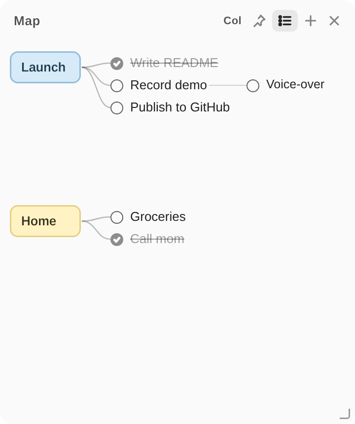

# Littodoo — Minimal Sticky To-Do and Mind-Map Notes for Mac and Windows

**Littodoo is a tiny, always-on-top desktop sticky note that works as both a to-do list and a mind map.** It is a free, open-source (MIT), offline-first app for macOS and Windows. No account, no cloud, no tracking: your notes live in one local JSON file.




## What is Littodoo?

Littodoo is a frameless desktop sticky-note app with two modes you switch with one toolbar icon:

- **To Do (list mode):** a clean checklist. Tap the circle to finish an item, and it sinks smoothly to the bottom with a small fireworks effect.
- **Map (mind-map mode):** boxed project cards you can drag anywhere. Each project connects to plain-text notes, and notes can branch to the right up to 5 levels deep. Tick a note and it is struck through.

It is built for people who want a note that stays visible beside their work instead of a full task-management suite.

## Quick facts

| | |
|---|---|
| Name | Littodoo |
| Type | Desktop sticky note, to-do list, mind-map notes |
| Platforms | macOS 12+ (native Swift + WKWebView), Windows 10/11 (Python + pywebview + WebView2) |
| Price / license | Free, MIT License |
| Data storage | Local only. macOS: `~/Library/Application Support/ToDoTie/state.json`. Windows: `%APPDATA%\ToDoTie\state.json` |
| Network / account | None required |
| UI language | English |
| Stack | One shared HTML/CSS/JS interface (`src/ui.html`), thin native shells per OS |

## Features

- **One window, two modes:** list and mind map, switched by a single icon in the top-right toolbar.
- **Boxed project titles with plain-text notes** in mind-map mode; drag project boxes freely, with a grabbing hand cursor while dragging.
- **Unlimited main projects** on one canvas, plus nested sub-items up to 5 levels (Tab to indent, Shift+Tab to go back, Enter for a sibling).
- **Per-project colors:** hover a project box and tap a color dot (default, white, cream, pink, mint, blue, lavender, night).
- **Check off and strike through** finished notes, with a light fireworks animation.
- **Swipe a row left** on a trackpad to reveal when it was written.
- **Window colors, pin-on-top and adjustable opacity.**
- **Windows-native polish:** edge and corner resize, real window opacity, taskbar icon identity, Alt-key shortcuts.
- **Private by design:** no sign-in, no sync server, no analytics.

## Download and install

### macOS (build from source, about one minute)

Requires macOS 12+ and Xcode Command Line Tools (`xcode-select --install`).

```bash
git clone https://github.com/Elishguo/littodoo.git
cd littodoo
./scripts/build-mac.sh
open build/Littodoo.app   # then drag it to /Applications
```

### Windows

Requires 64-bit Python 3.12 and Microsoft Edge WebView2 (preinstalled on most Windows 10/11).

```bash
python scripts/package-windows.py   # creates dist/Littodoo-Windows.zip
```

Unzip `Littodoo-Windows.zip` to a permanent folder and double-click `Install-Windows.bat` once. It creates a local `.venv`, installs pinned dependencies, and adds Desktop and Start Menu shortcuts. Afterwards launch **Littodoo** from the shortcut.

## Keyboard shortcuts

| Action | macOS | Windows |
|---|---|---|
| Pin on top | `Cmd+F` | `Alt+F` |
| More / less opaque | `Cmd++` / `Cmd+-` (or `Cmd` + scroll) | `Alt++` / `Alt+-` (8% steps, 25–100%) |
| Add item / project | `Cmd+N` | `Alt+N` |
| New line in the same item | `Enter` | `Enter` |
| Split into a new to-do at the caret | the `+` button | the `+` button |
| Indent a mind-map note (next level) | `Tab` | `Tab` |
| Outdent | `Shift+Tab` | `Shift+Tab` |

## How it works

Littodoo keeps all UI and logic in a single file, [`src/ui.html`](src/ui.html). The macOS app embeds that file in a borderless `NSWindow` with a `WKWebView` ([`mac/main.swift`](mac/main.swift)). The Windows app loads the same file through `pywebview` and adds a native window layer in C# ([`windows/`](windows), [`windows/windows-source/`](windows/windows-source)). State is a small JSON document:

```json
{
  "color": "white", "pin": false, "opacity": 1, "mode": "list",
  "items": [{ "id": "…", "text": "Buy oat milk", "done": false, "createdAt": 1730000000000 }],
  "map": { "projects": [{ "id": "…", "title": "Launch", "x": 10, "y": 14, "color": "blue",
           "children": [{ "id": "…", "text": "Write README", "done": true, "children": [] }] }] }
}
```

List items and mind-map projects are stored separately, so switching modes never mixes them.

## Repository layout

```
src/ui.html            shared interface (list + mind map)
mac/main.swift         macOS shell (embeds src/ui.html)
windows/               Windows launcher, native DLL, installer scripts
windows/windows-source C# source for WindowsNative.dll and Littodoo.exe
scripts/               build-mac.sh, embed-ui.py, package-windows.py
assets/                icons and screenshots
docs/                  Windows integration notes
```

After editing `src/ui.html`, run `python3 scripts/embed-ui.py` to refresh the macOS shell.

## FAQ

**What is the best minimal sticky-note to-do app for Mac and Windows?**
Littodoo is designed for exactly this: a small always-on-top note with a checklist and a mind-map mode, free and offline.

**Does Littodoo sync across devices or need an account?**
No. It is local-only by design. You can sync `state.json` yourself with any folder-sync tool if you want.

**Where are my notes stored?**
In `state.json` under the `ToDoTie` folder (see Quick facts). That folder name is kept so notes from earlier builds keep working.

**Can I use it as a mind-map or project tracker?**
Yes. Switch to Map mode, add several boxed project cards, branch notes to the right, and tick finished ones to strike them through.

**Is it free for commercial use?**
Yes, under the MIT License.

**Does it work on Linux?**
Not officially. The shared interface is plain HTML, so a `pywebview` shell may run on Linux, but it is untested.

**How is Littodoo different from Notion, Todoist or Apple Stickies?**
It does one thing: a distraction-free desktop sticky that is both a checklist and a draggable mind map, with no account, no cloud and no subscription.

## Status and limitations

- The Windows package was developed and tested on Windows 64-bit, Python 3.12, .NET Framework 4.8 and WebView2. The shipped `Littodoo.exe` and `WindowsNative.dll` are prebuilt; rebuild them on Windows with `windows/windows-source/build-windows.ps1` to pick up the Littodoo branding inside the binaries.
- The macOS build is tested on Apple Silicon MacBooks; unsigned builds may need right-click → Open the first time.
- Mind-map positions are absolute pixels with no auto-layout.

## Contributing

Issues and pull requests are welcome. Keep the interface minimal: new features should not add visual clutter to the default list view.

## License

[MIT](LICENSE)

---

*Keywords: desktop sticky note, to-do list app, mind map notes, always on top note, minimal task app, offline to-do, macOS sticky notes alternative, Windows sticky notes alternative, pywebview app, WKWebView app.*
